# Manual de uso — Clínica Buena Salud

**Sitio web de turnos, historial clínico y gestión de solicitudes**

| Dato | Valor |
|---|---|
| Versión del manual | 1.0 |
| Fecha | 28/10/2026 |
| Aplicación | Clínica Buena Salud (Next.js + PostgreSQL) |
| Público destinatario | Pacientes, recepción, médicos, administración y soporte |
| Alcance | Sitio público, centro de ayuda, acceso, portal del paciente, recepción, médico, administrador y uso móvil |

> Este manual describe la aplicación tal como está implementada en esta versión. Las pantallas fueron capturadas con datos de demostración; los nombres, fechas y turnos que aparecen son ficticios.

---

## Índice

1. [Introducción](#sec1)
2. [Primer contacto con el sitio](#sec2)
3. [Centro de ayuda y solicitud por WhatsApp](#sec3)
4. [Ingreso, registro y doble factor (2FA)](#sec4)
5. [Portal del paciente](#sec5)
6. [Recepción](#sec6)
7. [Médico](#sec7)
8. [Administrador](#sec8)
9. [Flujos de trabajo completos](#sec9)
10. [Uso en móvil y accesibilidad](#sec10)
11. [Credenciales demo y datos de ejemplo](#sec11)
12. [Solución de problemas](#sec12)
13. [Seguridad, privacidad y buenas prácticas](#sec13)
14. [Glosario](#sec14)
15. [Anexos](#sec15)
16. [Control de versiones](#sec16)

---

<a id="sec1"></a>
## 1. Introducción

### 1.1 Para qué sirve este manual

Este manual explica, paso a paso, cómo usar todas las pantallas de **Clínica Buena Salud**: desde la página pública y el centro de ayuda hasta la reserva de turnos, el historial clínico y la gestión diaria de recepción, médicos y administración.

Está pensado para cuatro situaciones:

- **Pacientes** que reservan un turno, crean su cuenta o consultan su historial.
- **Recepción** que atiende solicitudes de WhatsApp, reserva turnos y actualiza la agenda.
- **Médicos** que ven su agenda y registran evoluciones clínicas.
- **Administración y soporte** que supervisan la agenda, las métricas y las solicitudes.

### 1.2 Alcance funcional

La aplicación cubre el circuito completo:

1. Un visitante conoce el sitio y las especialidades.
2. Puede pedir un turno por WhatsApp **sin crear cuenta** o reservar online **con cuenta**.
3. Recepción recibe la solicitud, contacta al paciente y puede reservar el turno desde la misma bandeja.
4. El paciente puede crear su cuenta con el mismo DNI y **recuperar automáticamente** su historial.
5. El médico atiende el turno y registra una **evolución clínica**.
6. El paciente ve sus turnos, solicitudes y evoluciones en su **historial clínico**.
7. Administración consulta la agenda, las solicitudes y los indicadores del dashboard.

### 1.3 Perfiles y permisos

| Perfil | Cómo ingresa | Qué puede hacer | Qué no puede hacer |
|---|---|---|---|
| **Visitante** | Sin cuenta | Ver el sitio, el centro de ayuda, pedir turno por WhatsApp y crear una cuenta | Reservar online sin cuenta; ver historiales |
| **Paciente** | DNI + contraseña | Ver sus turnos, su historial, reservar online y pedir turno por WhatsApp | Ver datos de otros pacientes; gestionar la agenda |
| **Recepción** | DNI + contraseña | Agenda semanal, reserva manual, reserva desde solicitudes, historial de pacientes y cambios de estado | Administrar métricas globales; configurar el sistema |
| **Médico** | Email + contraseña + 2FA | Ver su agenda diaria, consultar el historial de sus pacientes y agregar evoluciones | Ver pacientes ajenos a su agenda; cancelar turnos |
| **Administrador** | Email + contraseña + 2FA | Agenda completa, dashboard de métricas, bandeja de solicitudes, reserva desde solicitudes e historiales | Nada propio del alcance administrativo; el sistema aplica las mismas reglas de negocio |

> **Importante:** el DNI es la identidad principal del paciente. Pacientes y recepción **no** ingresan con email. Médicos y administradores **sí** usan email y tienen 2FA obligatorio.

### 1.4 Cómo leer este manual

- Los textos entre comillas y en **negrita** son botones, títulos o etiquetas que se ven en pantalla.
- Las rutas de archivos se muestran como `docs/manual/img/...`.
- Las notas con fondo de cita (`>`) contienen advertencias, atajos o aclaraciones.
- Cada sección indica el perfil al que está dirigida.
- Las figuras están numeradas y muestran la pantalla real de la aplicación.

---

<a id="sec2"></a>
## 2. Primer contacto con el sitio

**Dirigido a:** visitantes y pacientes.

### 2.1 Dirección y requisitos

La aplicación se abre en el navegador con la dirección que indique el equipo:

```text
http://localhost:3000
```

En producción se usa el dominio público de la clínica. Se recomienda un navegador actualizado (Chrome, Edge, Firefox o Safari) y una conexión estable. No es necesario instalar nada.

### 2.2 Página de inicio

Al entrar se muestra la portada institucional. La parte superior tiene la marca, el botón **Ingresar** y el botón **Reservar turno**. La portada presenta el mensaje principal, dos accesos grandes y tres beneficios destacados: **40+ especialistas**, **3 sedes exclusivas** y **Turnos en 60 segundos**.

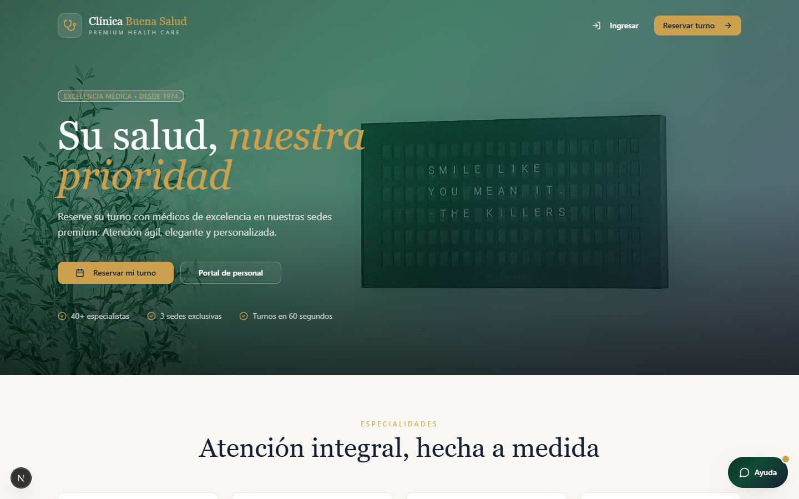

**Figura 1.** Portada del sitio. Arriba a la derecha están los accesos **Ingresar** y **Reservar turno**; abajo a la derecha, el botón flotante **Ayuda**.

Al desplazarse hacia abajo se ve la sección **Especialidades** con ocho tarjetas: Cardiología, Dermatología, Pediatría, Ginecología, Traumatología, Oftalmología, Neurología y Clínica Médica.

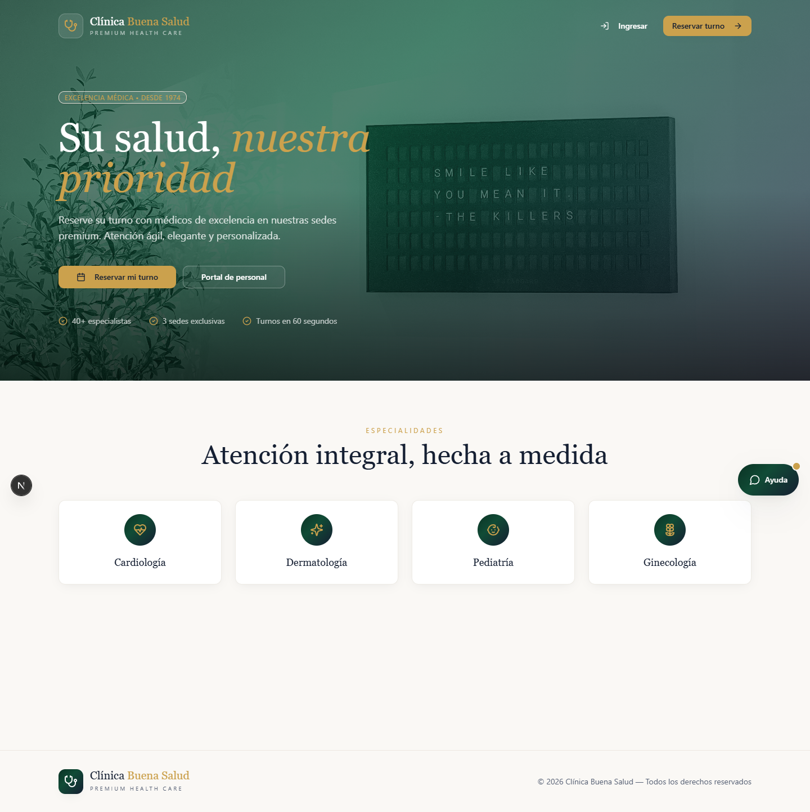

**Figura 2.** Página de inicio completa, con la sección de especialidades y el pie de página.

### 2.3 Cabecera, accesos y pie de página

| Elemento | Ubicación | Acción |
|---|---|---|
| **Ingresar** | Arriba a la derecha | Abre la pantalla de ingreso al portal |
| **Reservar turno** | Arriba a la derecha | Inicia la reserva; si no hay sesión, pide ingreso o registro |
| **Reservar mi turno** | Dentro de la portada | Igual que **Reservar turno** |
| **Portal de personal** | Dentro de la portada | Abre el ingreso para personal de la clínica |
| **Ayuda** | Abajo a la derecha | Abre el centro de ayuda |
| Tarjetas de especialidad | Sección **Especialidades** | Inician la reserva con esa especialidad preseleccionada |
| Pie de página | Al final | Muestra la marca y el aviso de derechos reservados |

> **Nota:** si se elige una especialidad desde una tarjeta y todavía no hay sesión, la aplicación conserva la intención de reserva y lleva al ingreso. Después de ingresar, continúa en el asistente de reserva.

### 2.4 Reserva desde una tarjeta de especialidad

1. En la portada, bajar hasta **Especialidades**.
2. Hacer clic en la tarjeta de la especialidad deseada.
3. Si ya hay una sesión de paciente, se abre el asistente en el paso de **Sede**.
4. Si no hay sesión, se abre **Ingreso al portal**; después de ingresar o crear la cuenta, la reserva continúa.

---

<a id="sec3"></a>
## 3. Centro de ayuda y solicitud por WhatsApp

**Dirigido a:** visitantes y pacientes.

### 3.1 Abrir el centro de ayuda

El botón flotante **Ayuda** está siempre en la esquina inferior derecha de la página pública. Al hacer clic se abre el panel **Centro de ayuda**, titulado **¿Cómo podemos ayudarte?**.

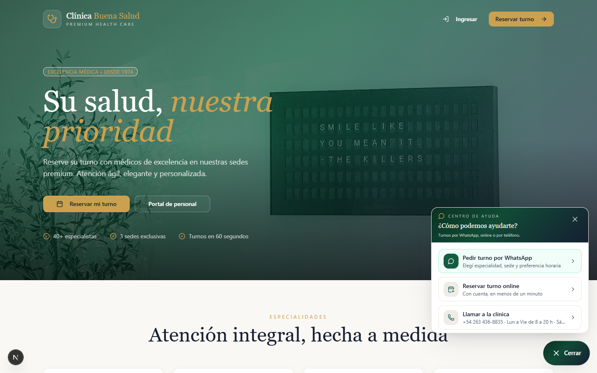

**Figura 3.** Panel del centro de ayuda con las tres acciones principales y las preguntas frecuentes.

Para cerrarlo se puede usar la **X** del panel, el botón **Cerrar** o la tecla `Escape`. En móvil, el panel ocupa el ancho de la pantalla y se abre por encima del contenido (ver sección 10).

### 3.2 Opciones del panel

| Opción | Para qué sirve |
|---|---|
| **Pedir turno por WhatsApp** | Abre un formulario corto; al enviarlo se registra la solicitud y se arma el mensaje de WhatsApp |
| **Reservar turno online** | Lleva al ingreso o registro y luego al asistente de reserva |
| **Llamar a la clínica** | Abre el marcador del teléfono con el número de la clínica |
| **Preguntas frecuentes** | Explica turnos, cuenta, datos pedidos, cancelaciones, coberturas, sedes y confirmación |
| **Aviso de urgencias** | Recuerda que el sitio no es un canal de urgencias: llamar al **107 (SAME)** o al **911** |
| **Aviso de privacidad** | Indica que los datos se usan solo para contactar por esa solicitud |

El horario que muestra el panel es **Lun a Vie de 8 a 20 h · Sáb de 8 a 13 h**. El teléfono y el número de WhatsApp se configuran por variables de entorno; en la demostración se muestra **+54 263 436-8835**.

### 3.3 Preguntas frecuentes

El panel incluye siete preguntas desplegables:

1. ¿Cómo saco un turno?
2. ¿Necesito crear una cuenta?
3. ¿Qué datos me van a pedir?
4. ¿Cómo cancelo o reprograma?
5. ¿Atienden obras sociales o prepagas?
6. ¿Dónde están las sedes?
7. ¿El turno queda confirmado al enviarlo?

Cada respuesta se abre y se cierra con un clic. La recomendación general es **no enviar datos médicos sensibles por chat**.

### 3.4 Solicitud de turno sin cuenta, paso a paso

1. Abrir **Ayuda**.
2. Hacer clic en **Pedir turno por WhatsApp**.
3. Completar el formulario:

| Campo | Obligatorio | Descripción |
|---|---|---|
| **Nombre y apellido** | Sí | Nombre completo del paciente |
| **DNI** | Sí | Documento del paciente; se usa para crear o vincular su ficha |
| **Especialidad** | Sí | Se elige de la lista cargada en el sistema |
| **Sede** | Sí | Centro, Norte o Sur, según la configuración |
| **¿Qué día u horario preferís?** | Sí | Texto libre, por ejemplo “martes por la mañana” |
| **Consulta o comentario** | No | Hasta 600 caracteres; no incluir datos médicos sensibles |

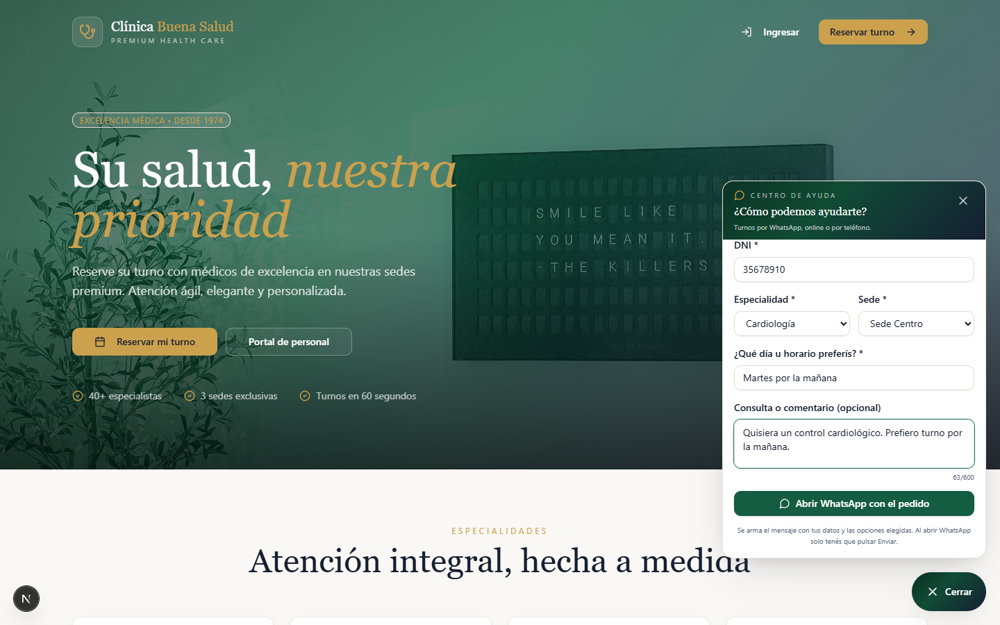

**Figura 4.** Formulario **Pedir turno por WhatsApp** completo. El contador del comentario muestra `0/600` cuando está vacío.

4. Hacer clic en **Abrir WhatsApp con el pedido**.

> **Atención:** este botón **registra la solicitud** y muestra la pantalla de confirmación. Todavía **no** abre WhatsApp. El envío real se hace en el paso siguiente.

### 3.5 Confirmación y envío del mensaje

Después de registrar la solicitud aparece la pantalla **Solicitud registrada**, con el mensaje ya armado.

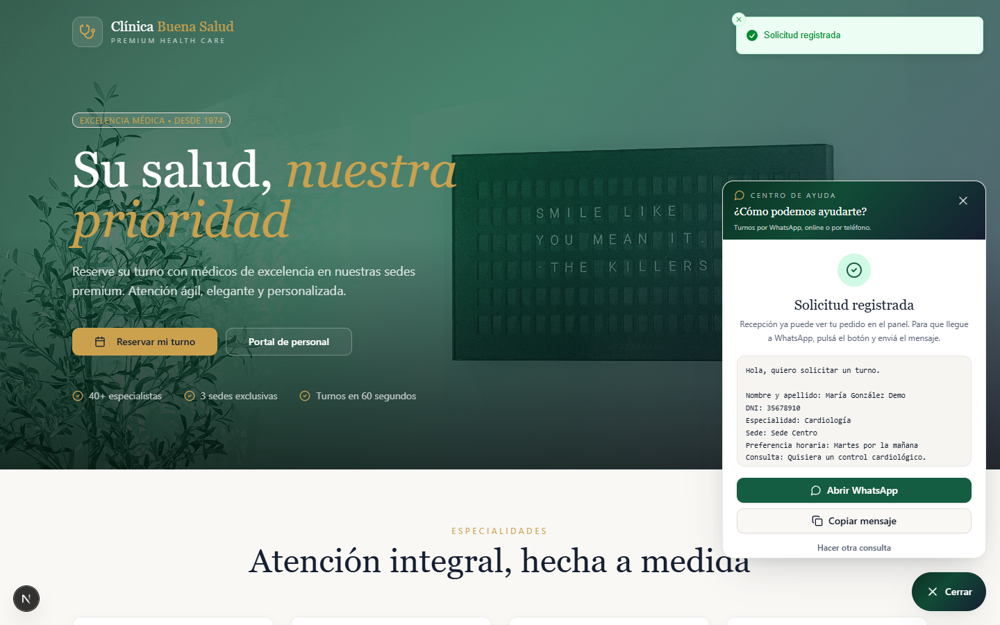

**Figura 5.** Confirmación de la solicitud. El mensaje incluye nombre, DNI, especialidad, sede, preferencia y consulta.

En esta pantalla hay tres acciones:

- **Abrir WhatsApp:** abre `wa.me` con el mensaje precargado. Solo queda pulsar **Enviar** dentro de WhatsApp.
- **Copiar mensaje:** copia el texto al portapapeles para pegarlo manualmente.
- **Hacer otra consulta:** vuelve al inicio del centro de ayuda y limpia el formulario.

> **Nota:** si el registro en el panel falla por un problema de red, la aplicación igualmente arma el mensaje y permite enviarlo por WhatsApp. En ese caso se muestra un aviso de que la solicitud no pudo guardarse en el panel.

### 3.6 Qué ocurre del lado de la clínica

Al registrar la solicitud:

1. Se crea una **solicitud de turno** en estado **Nueva**.
2. Se crea o vincula la ficha del paciente por **DNI**.
3. La solicitud aparece en **Solicitudes** para recepción y administración.
4. Recepción puede contactar al paciente por WhatsApp o teléfono.
5. Si el paciente no tiene cuenta, se muestra **Cuenta pendiente**. Cuando se registre con el mismo DNI, podrá reclamar su historial.
6. Recepción puede usar **Reservar turno** desde la solicitud para cargar el turno directamente.

### 3.7 Buenas prácticas para el visitante

- Usar el DNI correcto: es la llave del historial.
- No escribir diagnósticos, estudios ni datos sensibles en **Consulta o comentario**.
- Revisar el mensaje antes de enviarlo por WhatsApp.
- Si no llega respuesta en el horario de atención, llamar a la clínica.
- Ante una urgencia, no usar el formulario: llamar al **107** o al **911**.

---

<a id="sec4"></a>
## 4. Ingreso, registro y doble factor (2FA)

**Dirigido a:** pacientes, recepción, médicos y administradores.

### 4.1 Panorama de accesos

La pantalla **Ingreso al portal** tiene cinco pestañas:

| Pestaña | Perfil | Credencial |
|---|---|---|
| **Paciente** | Paciente | DNI + contraseña |
| **Médico** | Médico | Email + contraseña + 2FA |
| **Recep.** | Recepción | DNI + contraseña |
| **Admin** | Administrador | Email + contraseña + 2FA |
| **Crear cuenta** | Nuevo paciente | Nombre, DNI, contraseña y datos opcionales |

### 4.2 Ingreso de pacientes por DNI

1. En la portada, hacer clic en **Ingresar**.
2. Quedarse en la pestaña **Paciente**.
3. Escribir el **DNI** sin puntos ni espacios.
4. Escribir la **contraseña**.
5. Hacer clic en **Ingresar**.

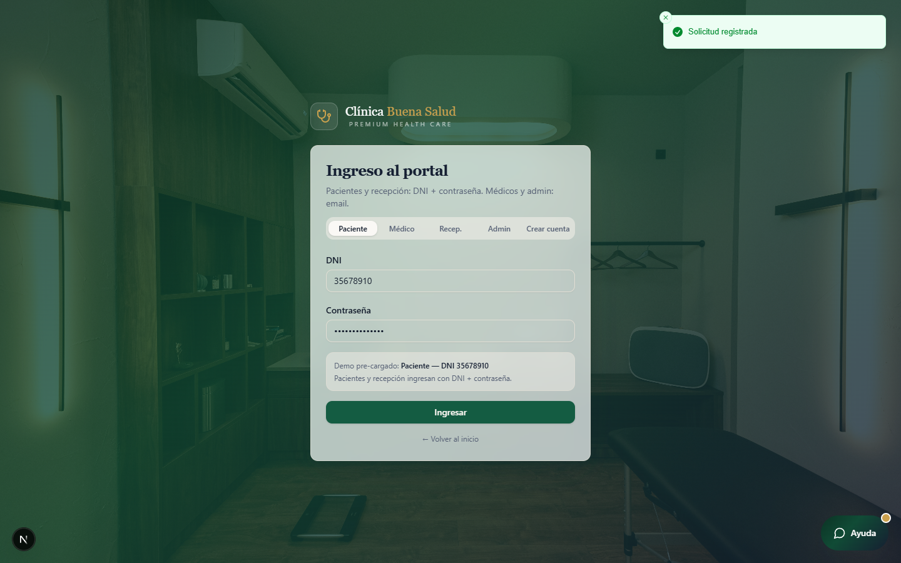

**Figura 6.** Pestaña **Paciente** del ingreso. El DNI es el usuario; la pantalla muestra además un acceso demo precargado.

Si los datos son correctos, se abre **Mis turnos**. Si el DNI no existe o la contraseña es incorrecta, se muestra un aviso y no se inicia sesión.

> **Seguridad:** después de cinco intentos fallidos, la cuenta se bloquea temporalmente durante 15 minutos. Esto protege a los pacientes de intentos de acceso no autorizados.

### 4.3 Crear una cuenta de paciente

1. En **Ingreso al portal**, hacer clic en la pestaña **Crear cuenta**.
2. Completar:

| Campo | Obligatorio | Observación |
|---|---|---|
| **Nombre completo** | Sí | Tal como figura en el documento |
| **DNI** | Sí | Será el usuario único de la cuenta |
| **Email (opcional)** | No | Se usa solo como dato de contacto |
| **Contraseña** | Sí | Mínimo 10 caracteres, con mayúscula, número y símbolo |
| **Teléfono (opcional)** | No | Se guarda cifrado |
| **Captcha** | Según configuración | Se muestra si el sitio tiene Turnstile activo |

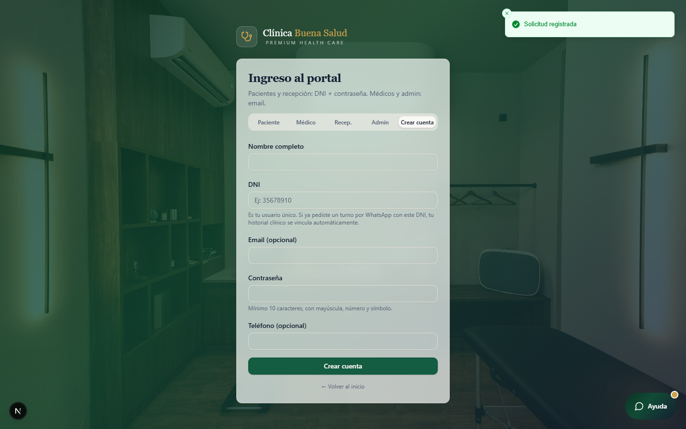

**Figura 7.** Formulario **Crear cuenta**. El texto bajo el DNI explica que el historial de WhatsApp se vincula automáticamente.

3. Hacer clic en **Crear cuenta**.
4. Si el DNI ya tenía una solicitud o una ficha creada por recepción, la aplicación **vincula el historial** y muestra un mensaje de bienvenida.
5. La sesión se inicia automáticamente y se abre **Mis turnos**.

> **Importante:** si al ingresar aparece el mensaje “Este DNI ya tiene una solicitud registrada”, no hay que crear una cuenta nueva con otro DNI. Hay que usar **Crear cuenta** con **el mismo DNI** para reclamar la ficha existente.

### 4.4 Recuperar el historial de una solicitud de WhatsApp

El flujo está pensado para que nadie pierda su historial:

1. El paciente pide un turno por WhatsApp sin cuenta.
2. La solicitud crea una ficha con su DNI.
3. Recepción puede reservar el turno desde esa ficha.
4. Más adelante, el paciente crea su cuenta con el **mismo DNI**.
5. La cuenta se vincula a la ficha existente y el paciente ve todos sus turnos, solicitudes y evoluciones.

Si el DNI no coincide, se crea una ficha distinta. Por eso es fundamental verificarlo al tomar la solicitud.

### 4.5 Ingreso de recepción

1. Abrir **Ingreso al portal**.
2. Elegir la pestaña **Recep.**
3. Escribir el **DNI** de la persona de recepción.
4. Escribir la contraseña.
5. Hacer clic en **Ingresar**.

La sesión abre directamente **Agenda semanal**. Recepción no usa 2FA en esta versión.

### 4.6 Ingreso de médicos y administradores

1. Abrir **Ingreso al portal**.
2. Elegir **Médico** o **Admin**.
3. Escribir el **email** institucional.
4. Escribir la contraseña.
5. Hacer clic en **Ingresar**.
6. Si es el primer ingreso, configurar 2FA (sección 4.7).
7. Si ya está configurado, ingresar el código de 6 dígitos (sección 4.8).

> **Nota:** el 2FA es obligatorio para médicos y administradores. Sin el código válido no se completa el ingreso.

### 4.7 Configurar 2FA en el primer ingreso

La primera vez que un médico o administrador ingresa, la aplicación pide configurar el doble factor.

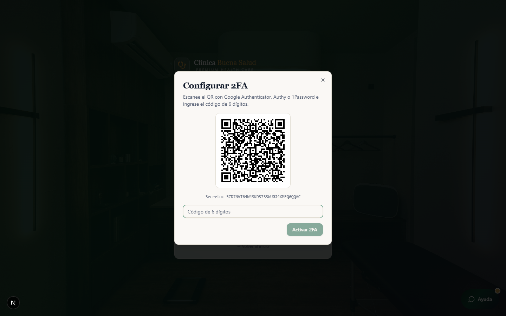

**Figura 8.** Pantalla **Configurar 2FA** con el código QR, el secreto y el campo para el código de 6 dígitos.

1. Abrir la aplicación autenticadora (Google Authenticator, Authy, 1Password u otra compatible con TOTP).
2. Escanear el **código QR**.
3. Si no se puede escanear, ingresar manualmente el **secreto** que aparece debajo del QR.
4. Escribir el **código de 6 dígitos** que muestra la aplicación.
5. Hacer clic en **Activar 2FA**.
6. Guardar los **códigos de recuperación** que se muestran una sola vez.

> **Muy importante:** los códigos de recuperación no se vuelven a mostrar. Guardarlos en un lugar seguro. Si se pierden el dispositivo y los códigos, hay que contactar al administrador del sistema.

### 4.8 Verificar 2FA en ingresos posteriores

1. Ingresar email y contraseña.
2. Cuando aparezca **Verificación 2FA**, abrir la aplicación autenticadora.
3. Escribir el código actual de 6 dígitos.
4. Hacer clic en **Verificar**.

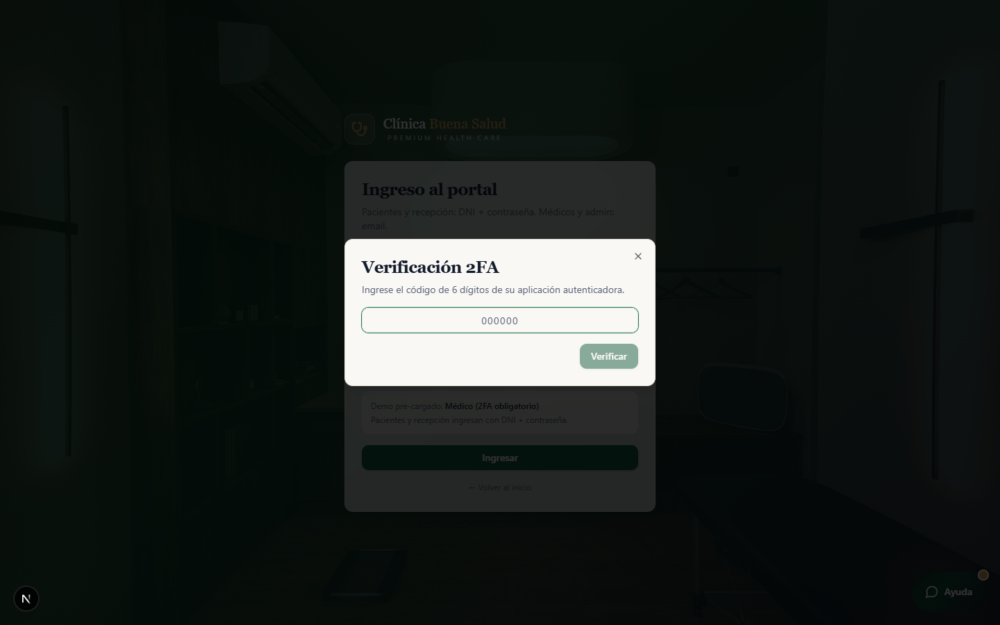

**Figura 9.** Diálogo **Verificación 2FA** para una cuenta que ya tiene el doble factor activo.

El código cambia cada 30 segundos aproximadamente. Si se rechaza, esperar al siguiente código y volver a intentar. Verificar que la hora del teléfono esté sincronizada automáticamente.

### 4.9 Cierre de sesión

En la cabecera del portal, a la derecha del nombre y el rol, hay un botón con el ícono de salida y el título **Cerrar sesión**. Al hacer clic se borra la sesión local y se vuelve a la portada.

> **Recomendación:** cerrar sesión siempre en equipos compartidos, especialmente en recepción y administración.

---

<a id="sec5"></a>
## 5. Portal del paciente

**Dirigido a:** pacientes con cuenta.

### 5.1 Estructura del portal

Después de ingresar, el paciente ve una cabecera con:

- La marca de la clínica.
- Los accesos **Mis turnos**, **Historial clínico** y **Reservar**.
- Su nombre y el rol **Paciente**.
- El botón **Cerrar sesión**.

La vista inicial es **Mis turnos**.

### 5.2 Mis turnos

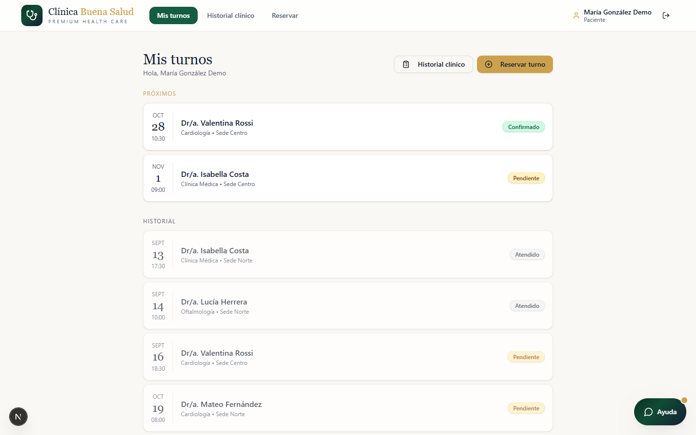

**Figura 10.** Pantalla **Mis turnos** con los turnos próximos, el historial y los accesos para reservar o ver el historial clínico.

La pantalla se divide en dos bloques:

- **Próximos:** turnos de hoy en adelante que no están cancelados, atendidos ni marcados como no asistió.
- **Historial:** turnos pasados o cerrados, que se muestran atenuados.

Cada tarjeta muestra fecha, hora, médico, especialidad, sede y estado. Los botones principales son:

| Botón | Acción |
|---|---|
| **Historial clínico** | Abre el historial completo del paciente |
| **Reservar turno** | Abre el asistente de reserva online |

> **Cancelaciones:** esta versión no muestra un botón de cancelación dentro del portal del paciente. Para cancelar o reprogramar, el paciente debe contactar a recepción por WhatsApp o teléfono. Recepción puede cancelar el turno desde la agenda.

### 5.3 Estados de un turno

| Estado | Significado |
|---|---|
| **Pendiente** | El turno fue reservado y espera confirmación de recepción |
| **Confirmado** | Recepción confirmó el turno |
| **En sala** | El paciente llegó y está en sala de espera |
| **Atendido** | El médico completó la atención |
| **Cancelado** | El turno fue cancelado |
| **No asistió** | El paciente no se presentó |

### 5.4 Historial clínico del paciente

Desde **Mis turnos**, hacer clic en **Historial clínico**. También se puede usar el acceso **Historial clínico** de la cabecera.

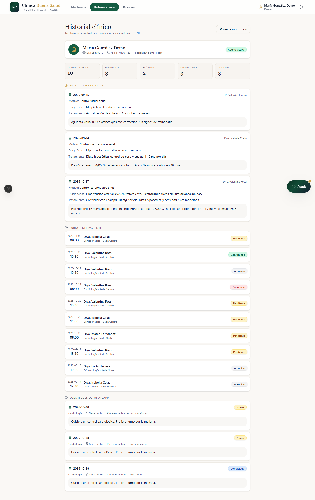

**Figura 11.** Historial clínico completo del paciente, con resumen, evoluciones, turnos y solicitudes de WhatsApp.

El historial se compone de:

1. **Ficha del paciente:** nombre, DNI, teléfono y email. El distintivo indica si la cuenta está activa o pendiente.
2. **Resumen:** turnos totales, atendidos, próximos, cantidad de evoluciones y cantidad de solicitudes.
3. **Evoluciones clínicas:** motivo, diagnóstico, tratamiento y notas de cada atención.
4. **Turnos del paciente:** todos los turnos con su estado.
5. **Solicitudes de WhatsApp:** pedidos registrados, con especialidad, sede, preferencia y mensaje.

El paciente solo puede ver su propio historial. La aplicación lo obtiene a partir de su sesión y su DNI.

### 5.5 Reserva online: paso 1, especialidad

1. En **Mis turnos**, hacer clic en **Reservar turno**.
2. Elegir una especialidad entre las tarjetas disponibles.

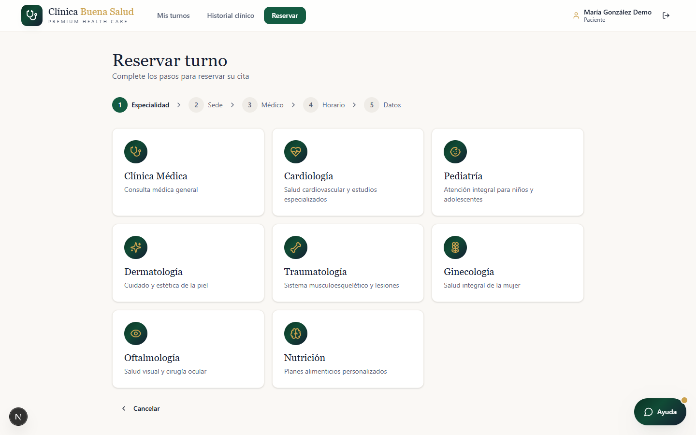

**Figura 12.** Paso 1 del asistente: **Especialidad**. Al elegir una tarjeta se avanza automáticamente al paso 2.

El asistente muestra los cinco pasos en la parte superior: **Especialidad → Sede → Médico → Horario → Datos**.

### 5.6 Reserva online: paso 2, sede

1. Elegir la sede donde se quiere atender.
2. La tarjeta muestra nombre, dirección y ciudad.

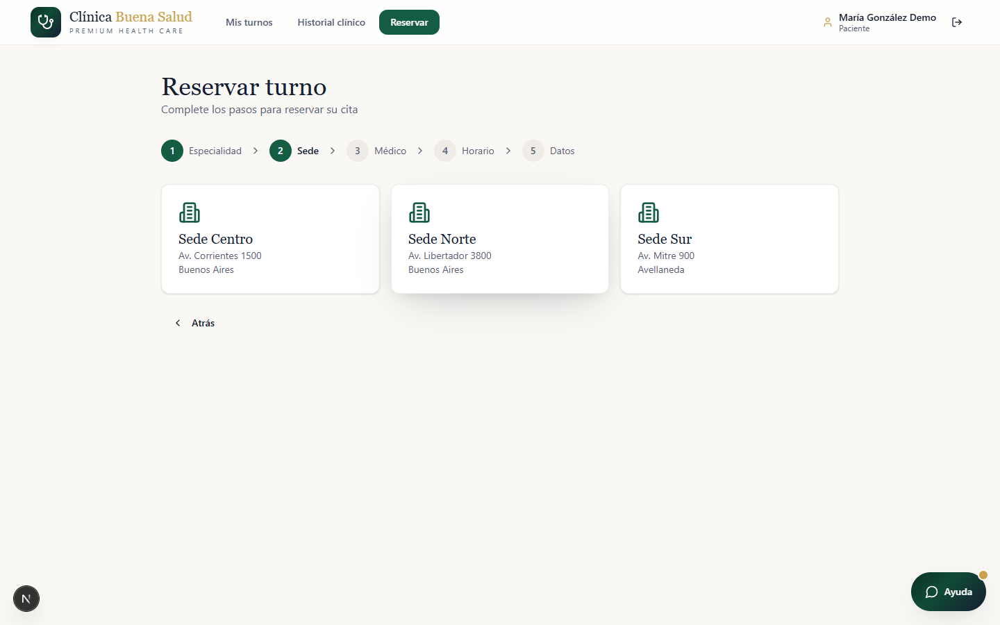

**Figura 13.** Paso 2: **Sede**. La selección condiciona los médicos y horarios disponibles.

### 5.7 Reserva online: paso 3, médico

1. Revisar los médicos disponibles para la especialidad y la sede elegidas.
2. Cada tarjeta muestra nombre, especialidad, breve biografía y honorario de consulta.
3. Hacer clic en el médico deseado.

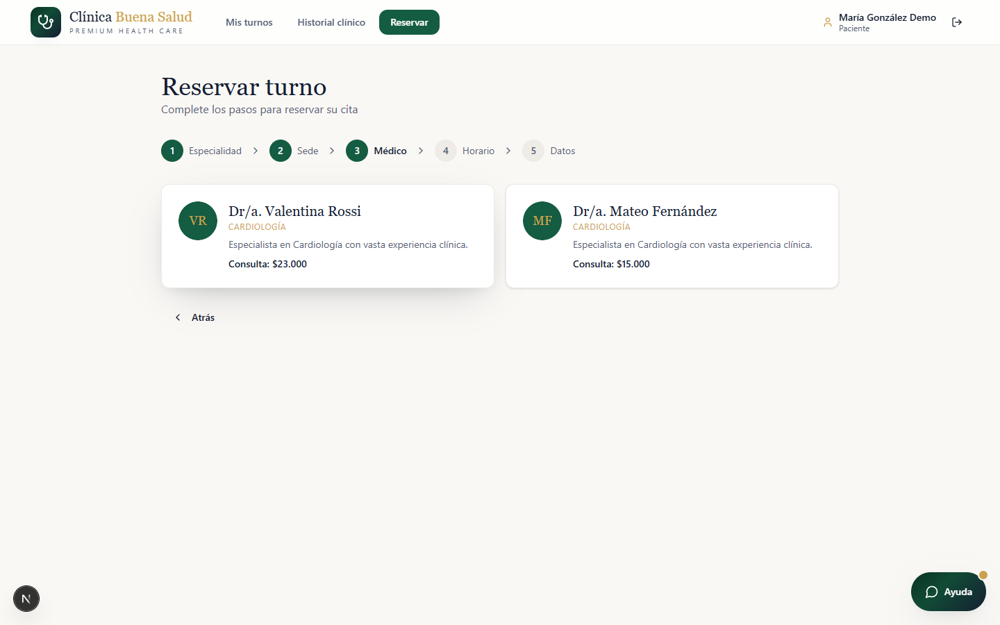

**Figura 14.** Paso 3: **Médico**. Solo se listan los profesionales que atienden en la especialidad y sede seleccionadas.

> **Nota:** si no hay médicos con esos filtros, se muestra “No hay médicos disponibles con estos filtros”. En ese caso, volver atrás y cambiar la sede o la especialidad.

### 5.8 Reserva online: paso 4, horario

1. Elegir la **fecha** en el selector.
2. Esperar a que se carguen los horarios disponibles.
3. Hacer clic en un horario habilitado.

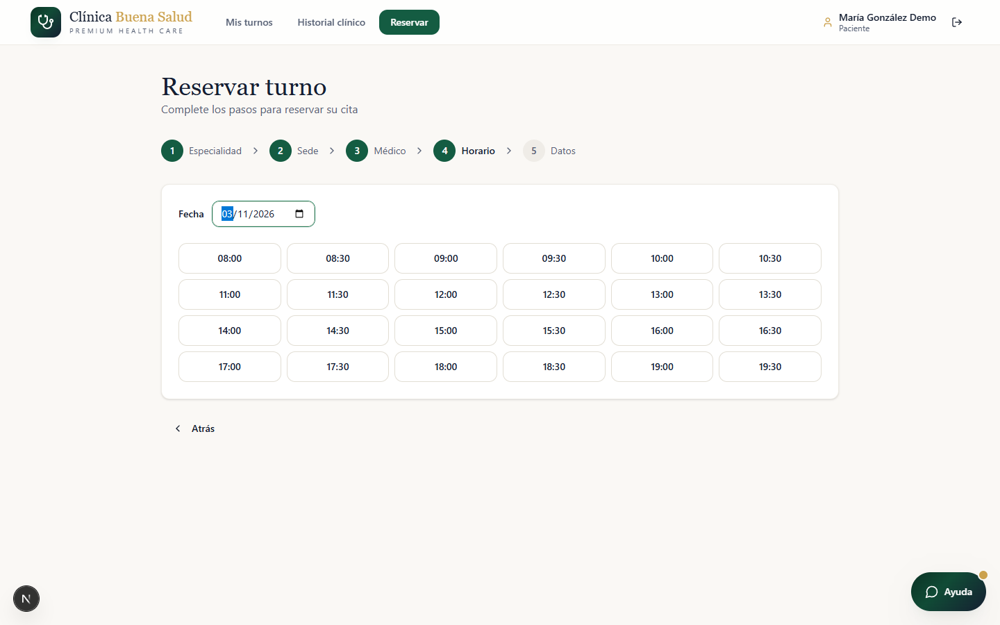

**Figura 15.** Paso 4: **Horario**. Los horarios ocupados o demasiado próximos aparecen deshabilitados.

Reglas importantes:

- Solo se puede reservar desde la fecha actual en adelante.
- Un turno debe tener al menos **2 horas de anticipación**.
- Los horarios ya reservados no se pueden elegir.
- Si no hay disponibilidad, se muestra “No hay disponibilidad en esta fecha” y hay que probar otra fecha, sede o médico.

### 5.9 Reserva online: paso 5, datos y confirmación

1. Revisar y completar los datos del paciente.
2. El **DNI** aparece bloqueado si el paciente ya tiene DNI en su cuenta.
3. Agregar email, teléfono y notas para el médico si hace falta.
4. Revisar el **Resumen** de la derecha: médico, especialidad, sede, fecha y hora.
5. Completar el captcha si el sitio lo solicita.
6. Hacer clic en **Confirmar reserva**.

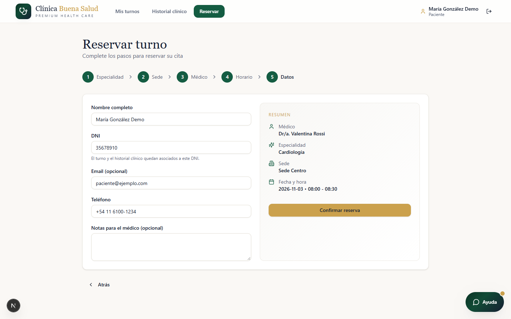

**Figura 16.** Paso 5: **Datos**. El resumen permite verificar toda la reserva antes de confirmar.

> **Importante:** el turno y el historial quedan asociados al DNI que se muestra en el formulario. Si el DNI no es correcto, el turno quedará vinculado a otra ficha.

### 5.10 Reserva confirmada

Si la reserva se guarda correctamente, se muestra **¡Turno confirmado!** con el detalle.

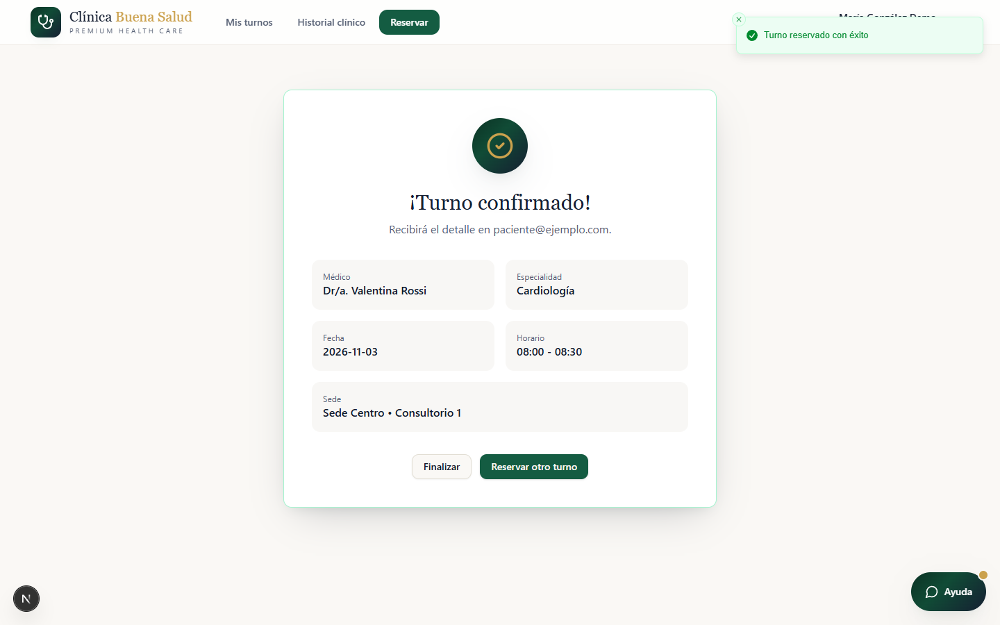

**Figura 17.** Confirmación de la reserva con médico, especialidad, fecha, horario y sede.

Acciones disponibles:

- **Finalizar:** vuelve a **Mis turnos**.
- **Reservar otro turno:** reinicia el asistente en el paso 1.

El turno se crea en estado **Pendiente** hasta que recepción lo confirme. El paciente puede verlo en **Mis turnos**.

### 5.11 Errores frecuentes al reservar

| Mensaje o situación | Causa | Qué hacer |
|---|---|---|
| “No hay disponibilidad en esta fecha” | No hay horarios libres para ese médico, sede y fecha | Probar otra fecha u otro médico |
| “El horario elegido ya no está disponible” | Otra persona tomó el turno mientras se completaba la reserva | Volver al paso 4 y elegir otro horario |
| “Los turnos requieren al menos 2 horas de anticipación” | Se intentó reservar un horario demasiado cercano | Elegir un horario posterior |
| “No hay médicos disponibles con estos filtros” | La combinación especialidad/sede no tiene profesionales | Cambiar sede o especialidad |
| La sesión se cierra o vuelve al inicio | La sesión expiró | Ingresar de nuevo y repetir la reserva |
| El captcha no permite continuar | Turnstile no se completó o falló | Recargar la página y completar el captcha |

---

<a id="sec6"></a>
## 6. Recepción

**Dirigido a:** personal de recepción.

### 6.1 Ingreso y pantalla inicial

1. Abrir **Ingreso al portal**.
2. Elegir **Recep.**
3. Ingresar **DNI + contraseña**.
4. Hacer clic en **Ingresar**.

La pantalla inicial es **Agenda semanal**. El menú de recepción tiene tres accesos:

- **Agenda**
- **Reservar**
- **Solicitudes**

### 6.2 Agenda semanal

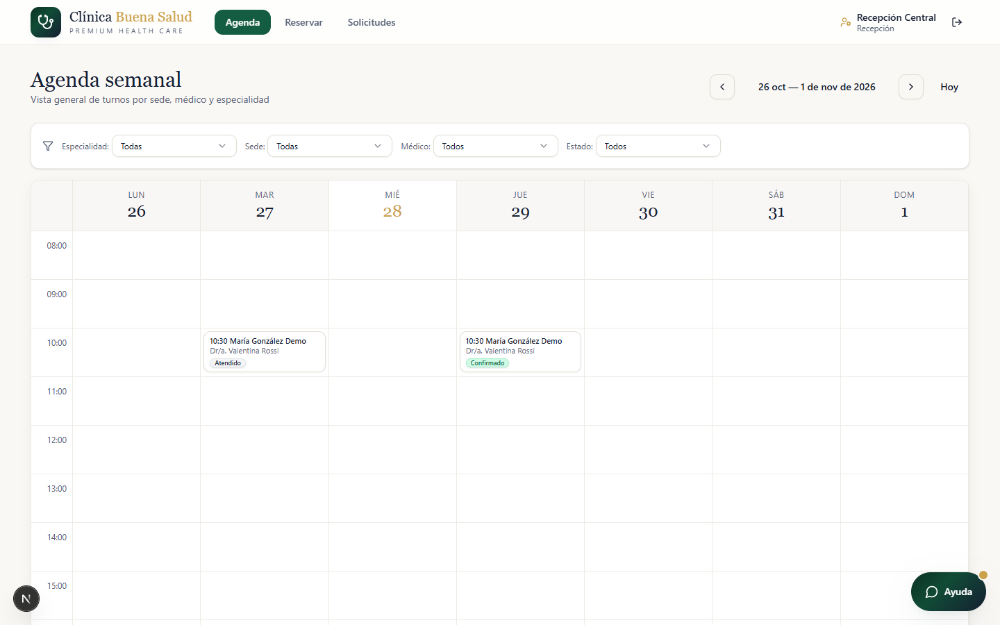

**Figura 18.** Agenda semanal de recepción con turnos por día, filtros y navegación por semanas.

La agenda muestra una grilla de **lunes a domingo**, de **08:00 a 17:00**, con los turnos ubicados por fecha y hora. Cada tarjeta indica hora, paciente, médico y estado.

Controles:

| Control | Acción |
|---|---|
| Flecha izquierda | Semana anterior |
| Flecha derecha | Semana siguiente |
| **Hoy** | Vuelve a la semana actual |
| **Especialidad** | Filtra por especialidad |
| **Sede** | Filtra por sede |
| **Médico** | Filtra por profesional |
| **Estado** | Filtra por estado del turno |

Los filtros se combinan. Para limpiar un filtro, elegir la opción **Todas** o **Todos**.

### 6.3 Detalle del turno y cambios de estado

Hacer clic en cualquier tarjeta de la agenda para abrir el detalle.

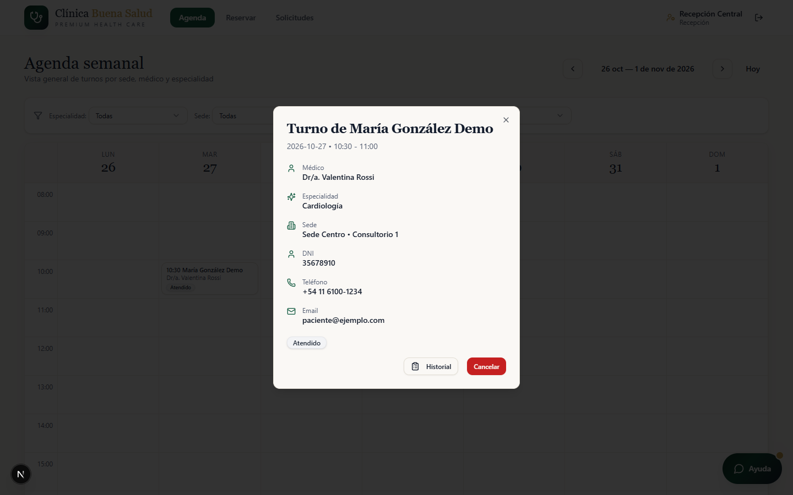

**Figura 19.** Detalle del turno con médico, especialidad, sede, DNI, teléfono, email, notas y estado.

El detalle permite:

| Botón | Cuándo aparece | Acción |
|---|---|---|
| **Historial** | El turno tiene paciente vinculado | Abre el historial clínico del paciente |
| **Confirmar** | Estado **Pendiente** | Pasa el turno a **Confirmado** |
| **Marcar en sala** | Estados **Pendiente** o **Confirmado** | Pasa el turno a **En sala** |
| **Atendido** | El turno no está atendido | Marca la atención como completada |
| **Cancelar** | El turno no está cancelado | Cancela el turno |

> **Cancelación tardía:** si se cancela un turno con menos de 24 horas de anticipación, el sistema registra la cancelación como tardía para su seguimiento.

### 6.4 Consultar el historial desde la agenda

1. Abrir el detalle de un turno.
2. Hacer clic en **Historial**.
3. Se abre el diálogo **Historial clínico**.

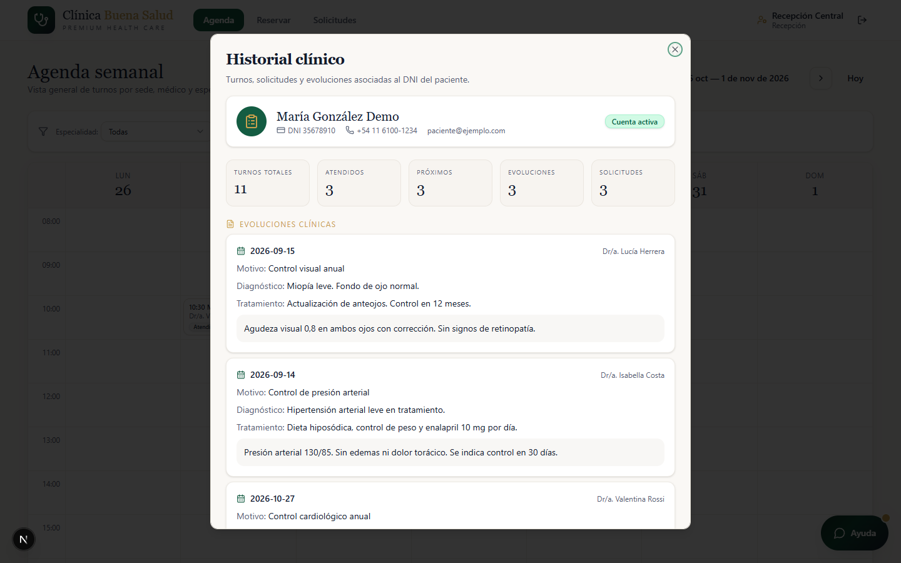

**Figura 20.** Historial clínico consultado por recepción desde la agenda.

Recepción puede consultar:

- Ficha del paciente y estado de la cuenta.
- Resumen de turnos, atenciones, evoluciones y solicitudes.
- Evoluciones clínicas.
- Turnos del paciente.
- Solicitudes de WhatsApp.

En esta vista recepción **no** agrega evoluciones; solo el médico lo hace desde su agenda.

### 6.5 Bandeja de solicitudes

El acceso **Solicitudes** abre la bandeja de pedidos recibidos desde el centro de ayuda.

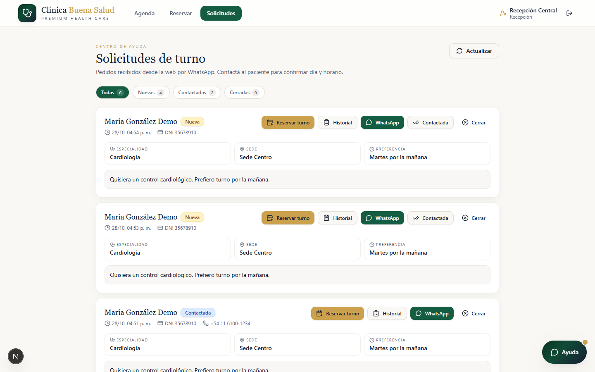

**Figura 21.** Bandeja **Solicitudes de turno** con filtros por estado y acciones por solicitud.

La bandeja muestra:

- Nombre del paciente y estado: **Nueva**, **Contactada** o **Cerrada**.
- Distintivo **Cuenta pendiente** si el paciente todavía no creó su cuenta.
- Fecha y hora de la solicitud, DNI y teléfono.
- Especialidad, sede y preferencia horaria.
- Mensaje o consulta del paciente.
- Botón **Actualizar** para recargar la lista.

Filtros disponibles: **Todas**, **Nuevas**, **Contactadas**, **Cerradas**, con el total de cada grupo.

Acciones por solicitud:

| Acción | Resultado |
|---|---|
| **Reservar turno** | Abre el asistente con los datos de la solicitud precargados |
| **Historial** | Abre el historial del paciente si ya tiene ficha |
| **WhatsApp** | Abre WhatsApp con un mensaje de respuesta precargado |
| **Contactada** | Marca la solicitud como contactada |
| **Cerrar** | Marca la solicitud como cerrada |

> **Recomendación:** usar **Contactada** cuando ya se habló con el paciente, y **Cerrar** cuando la solicitud se resolvió o el paciente desistió. Así la bandeja refleja el trabajo real.

### 6.6 Reservar un turno desde una solicitud de WhatsApp

Este es el flujo central para pedidos que llegan por WhatsApp.

1. Abrir **Solicitudes**.
2. Ubicar la solicitud y hacer clic en **Reservar turno**.
3. El asistente se abre con **nombre, DNI, teléfono, especialidad y sede** precargados.
4. Si la solicitud ya trae especialidad y sede, el asistente arranca en el paso **Médico**. Si falta algún dato, arranca antes.
5. Verificar la identidad del paciente en el recuadro superior.
6. Elegir médico, fecha y horario.
7. Completar o revisar los datos y confirmar.

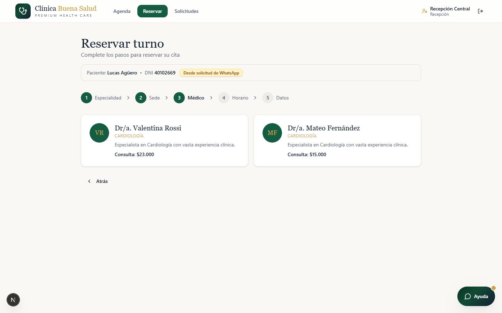

**Figura 22.** Asistente abierto desde una solicitud. El recuadro superior muestra el paciente y el distintivo **Desde solicitud de WhatsApp**.

En el paso de datos se ve el resumen y el formulario del paciente.

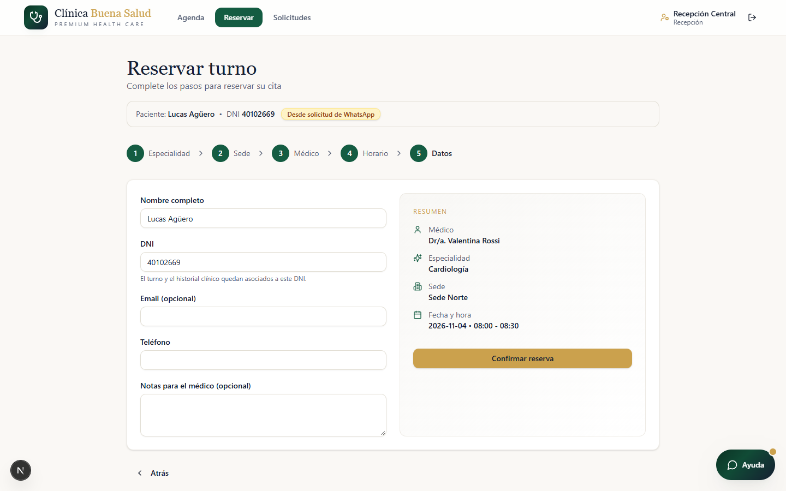

**Figura 23.** Paso **Datos** de una reserva gestionada por recepción. El turno se asocia al DNI del paciente, no a la cuenta de recepción.

Al confirmar se muestra **¡Turno confirmado!** y la solicitud pasa automáticamente a **Contactada**.

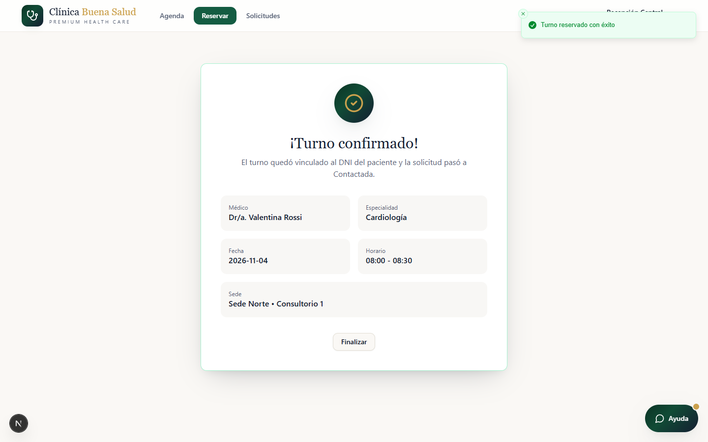

**Figura 24.** Confirmación de la reserva creada desde una solicitud de WhatsApp.

> **Regla clave:** el turno pertenece al **paciente identificado por su DNI**. Aunque quien opera sea recepción, el sistema ignora cualquier intención de asociar el turno a la cuenta de recepción y exige el DNI del paciente. Nunca se debe reservar un turno a nombre del personal.

Después de confirmar, la aplicación vuelve a **Solicitudes** para seguir atendiendo la bandeja.

### 6.7 Reserva manual desde el menú Reservar

El acceso **Reservar** del menú sirve para cargar un turno de forma manual, por ejemplo para una persona que llama por teléfono o se presenta en el mostrador.

1. Hacer clic en **Reservar**.
2. Elegir **Especialidad**.
3. Elegir **Sede**.
4. Elegir **Médico**.
5. Elegir **Fecha** y **Horario**.
6. Completar los datos del paciente.
7. Confirmar la reserva.

El formulario de datos incluye:

- **Nombre completo**
- **DNI** (obligatorio)
- **Email (opcional)**
- **Teléfono**
- **Notas para el médico (opcional)**

> **Importante:** el DNI es obligatorio. Si el paciente no tiene cuenta, se crea o vincula una ficha con **Cuenta pendiente**. Cuando el paciente se registre con ese DNI, podrá ver su historial.

### 6.8 Identidad del paciente y DNI

El DNI es la clave que une turnos, solicitudes y evoluciones. Por eso:

- Verificar el DNI con el paciente antes de confirmar.
- No usar el DNI de otra persona ni el del personal.
- Si el paciente dicta el DNI con puntos, el sistema lo normaliza; aun así, confirmar los dígitos.
- Si el DNI ya existe, la reserva se vincula a la ficha existente.
- Si el DNI no existe, se crea una ficha nueva.
- Si el paciente ya tiene cuenta, el turno aparecerá en su portal.

### 6.9 Checklist diaria de recepción

- [ ] Ingresar con DNI y contraseña.
- [ ] Revisar la agenda de la semana y los turnos del día.
- [ ] Confirmar los turnos pendientes.
- [ ] Revisar la bandeja de **Solicitudes** y responder las nuevas.
- [ ] Reservar los turnos pedidos por WhatsApp usando **Reservar turno**.
- [ ] Marcar **En sala** cuando llega el paciente.
- [ ] Marcar **Atendido** cuando termina la atención (el **No asistió** se registra desde la agenda del médico).
- [ ] Cancelar o reprogramar los turnos avisados.
- [ ] Cerrar sesión al terminar el turno.

---

<a id="sec7"></a>
## 7. Médico

**Dirigido a:** médicos con cuenta institucional.

### 7.1 Ingreso

1. Abrir **Ingreso al portal**.
2. Elegir la pestaña **Médico**.
3. Ingresar **email + contraseña**.
4. Completar **2FA**.
5. La pantalla inicial es **Mi agenda**.

### 7.2 Mi agenda

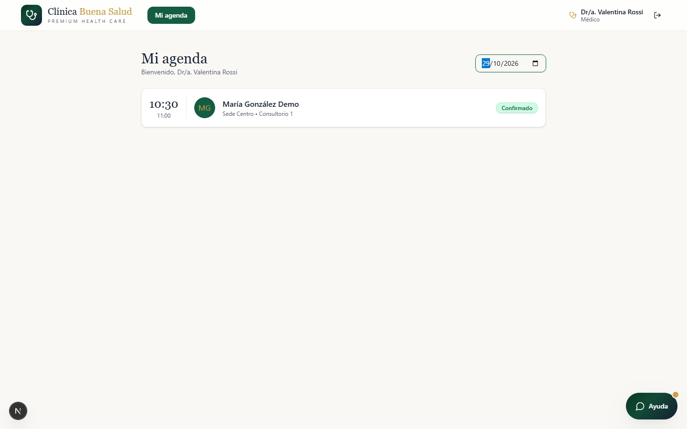

**Figura 25.** Pantalla **Mi agenda** del médico, con selector de fecha y listado de turnos.

La agenda del médico muestra un solo día. Para cambiar de fecha, usar el selector **Fecha**. Cada tarjeta indica:

- Hora de inicio y fin.
- Nombre del paciente.
- Sede y consultorio.
- Estado del turno.

Si no hay turnos, se muestra **Sin turnos para esta fecha**.

### 7.3 Detalle del turno

Hacer clic en una tarjeta para abrir el detalle.

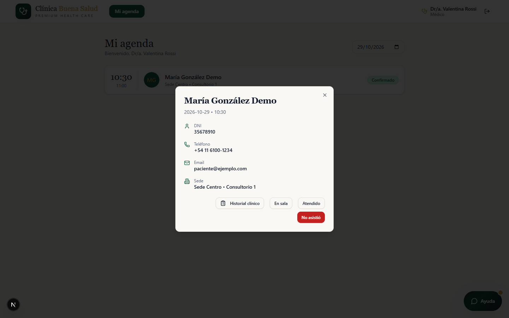

**Figura 26.** Detalle del turno con DNI, teléfono, email, sede, notas y acciones de estado.

El médico puede:

| Botón | Acción |
|---|---|
| **Historial clínico** | Abre el historial del paciente |
| **Confirmar** | Confirma un turno pendiente |
| **En sala** | Marca que el paciente está en sala |
| **Atendido** | Marca la atención como completada |
| **No asistió** | Registra que el paciente no se presentó |

> **Nota:** el médico no tiene botón **Cancelar**. Las cancelaciones las gestiona recepción. El médico solo puede consultar pacientes que hayan tenido o tengan un turno con él.

### 7.4 Historial clínico del paciente

1. Abrir el detalle de un turno.
2. Hacer clic en **Historial clínico**.

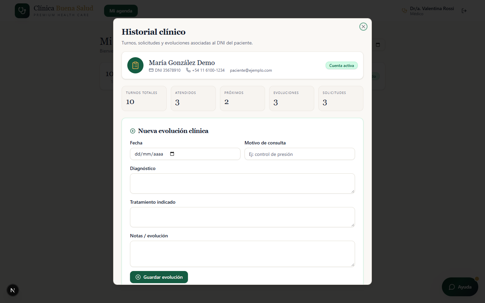

**Figura 27.** Historial clínico abierto desde la agenda del médico.

El médico ve la ficha, el resumen, las evoluciones, los turnos y las solicitudes del paciente. Además, al abrirlo desde un turno, el formulario de nueva evolución queda asociado a ese turno.

### 7.5 Agregar una nueva evolución clínica

1. Abrir el historial del paciente.
2. Ir al formulario **Nueva evolución clínica**.
3. Completar:

| Campo | Obligatorio | Descripción |
|---|---|---|
| **Fecha** | No | Si se omite, se usa la fecha actual |
| **Motivo de consulta** | Al menos uno de motivo, diagnóstico o notas | Ejemplo: “control de presión” |
| **Diagnóstico** | Al menos uno | Diagnóstico o impresión clínica |
| **Tratamiento indicado** | No | Medicación, estudios o indicaciones |
| **Notas / evolución** | Al menos uno | Detalle de la atención |

4. Hacer clic en **Guardar evolución**.

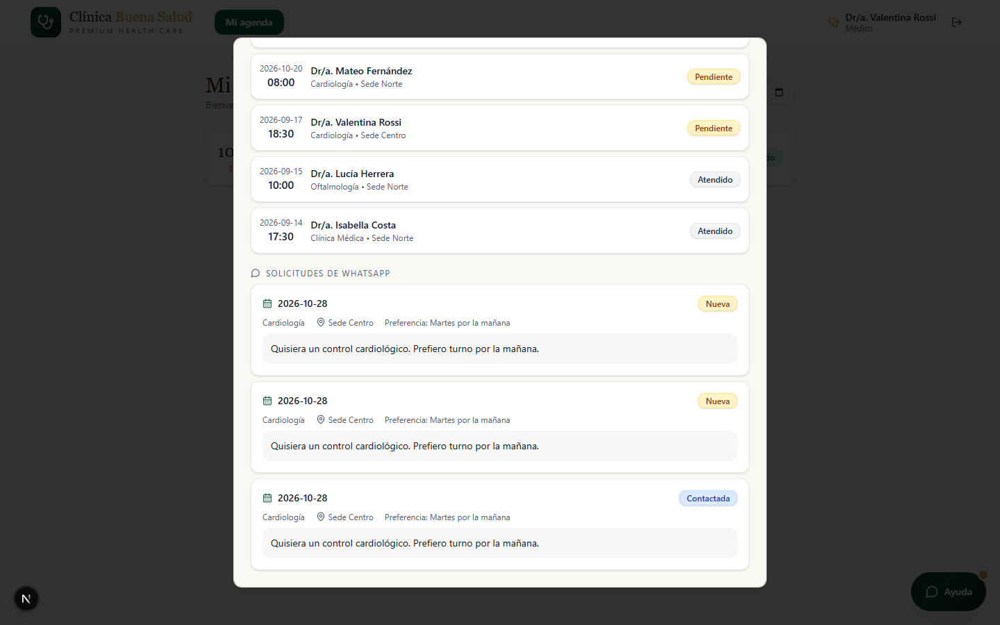

**Figura 28.** Formulario **Nueva evolución clínica** dentro del historial del paciente.

La evolución se guarda y aparece inmediatamente en el historial. También queda visible para el paciente en su portal.

> **Buenas prácticas:** registrar la evolución durante o inmediatamente después de la atención; no incluir datos de terceros; ser claro y objetivo; no borrar ni reescribir evoluciones anteriores (si hace falta corregir, agregar una nueva nota aclaratoria).

### 7.6 Alcance y privacidad

- El médico solo accede a pacientes de su propia agenda.
- Si intenta abrir un historial ajeno, la API rechaza la solicitud.
- Las evoluciones quedan asociadas al paciente y al turno cuando se abren desde la agenda.
- El historial es información sensible: no compartir pantalla ni credenciales.
- Cerrar sesión al terminar la jornada.

---

<a id="sec8"></a>
## 8. Administrador

**Dirigido a:** administración del sistema.

### 8.1 Ingreso

1. Abrir **Ingreso al portal**.
2. Elegir **Admin**.
3. Ingresar **email + contraseña**.
4. Completar **2FA**.
5. La pantalla inicial es **Agenda semanal**.

El menú de administración tiene:

- **Agenda**
- **Dashboard**
- **Solicitudes**

### 8.2 Dashboard

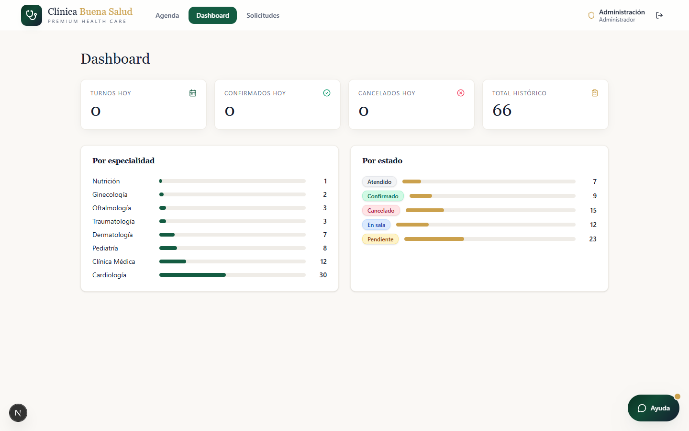

**Figura 29.** Dashboard con indicadores del día y distribución de turnos por especialidad y estado.

El dashboard muestra cuatro indicadores:

| Indicador | Qué mide |
|---|---|
| **Turnos hoy** | Turnos registrados para la fecha actual |
| **Confirmados hoy** | Turnos confirmados para hoy |
| **Cancelados hoy** | Turnos cancelados para hoy |
| **Total histórico** | Todos los turnos registrados |

Debajo se muestran dos gráficos de barras:

- **Por especialidad:** cantidad de turnos por especialidad.
- **Por estado:** cantidad de turnos por estado (pendiente, confirmado, en sala, atendido, cancelado, no asistió).

Los datos se actualizan al volver a entrar o recargar la vista.

### 8.3 Agenda

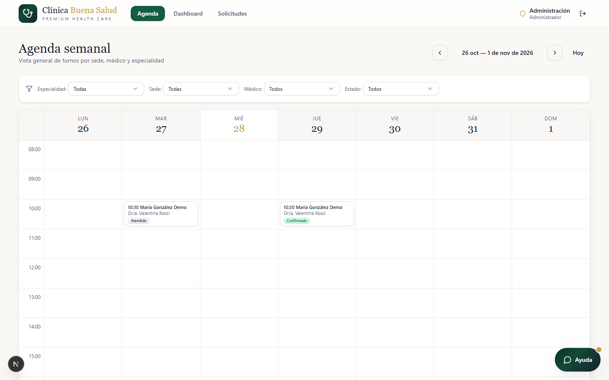

**Figura 30.** Agenda semanal del administrador, con la misma vista y filtros que recepción.

La agenda del administrador funciona igual que la de recepción:

- Navegación por semanas y botón **Hoy**.
- Filtros por especialidad, sede, médico y estado.
- Detalle del turno con **Historial**, **Confirmar**, **Marcar en sala**, **Atendido** y **Cancelar**.

### 8.4 Solicitudes

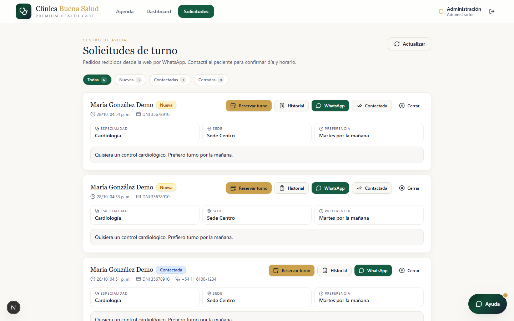

**Figura 31.** Bandeja de solicitudes del administrador, con las mismas acciones que recepción.

La bandeja es la misma que la de recepción: filtros, estados, datos del paciente, **Reservar turno**, **Historial**, **WhatsApp**, **Contactada** y **Cerrar**.

### 8.5 Tareas habituales y diferencias con recepción

| Tarea | Recepción | Administrador |
|---|---|---|
| Ver agenda semanal | Sí | Sí |
| Reservar turno manual | Sí, desde **Reservar** | Solo desde una solicitud de la bandeja |
| Reservar desde solicitud | Sí | Sí |
| Consultar historial | Sí | Sí |
| Ver dashboard | No | Sí |
| Recargar datos demo / seed | No | Sí, con permisos especiales |
| 2FA obligatorio | No | Sí |

> **Nota:** el administrador tiene una visión global, pero las reglas de negocio son las mismas: los turnos se asocian al DNI del paciente y las validaciones de disponibilidad y anticipación se aplican igual.

---

<a id="sec9"></a>
## 9. Flujos de trabajo completos

### 9.1 Solicitud por WhatsApp → turno → evolución → historial

1. **Visitante:** abre **Ayuda** y elige **Pedir turno por WhatsApp**.
2. **Visitante:** completa nombre, DNI, especialidad, sede y preferencia.
3. **Visitante:** pulsa **Abrir WhatsApp con el pedido** y luego **Abrir WhatsApp** para enviar el mensaje.
4. **Sistema:** guarda la solicitud en estado **Nueva** y crea o vincula la ficha por DNI.
5. **Recepción:** abre **Solicitudes**, revisa el pedido y contacta al paciente.
6. **Recepción:** pulsa **Reservar turno**, elige médico, fecha y horario, y confirma.
7. **Sistema:** crea el turno asociado al DNI y marca la solicitud como **Contactada**.
8. **Paciente:** si aún no tiene cuenta, se registra con el mismo DNI y reclama su historial.
9. **Recepción/médico:** confirman el turno y lo marcan **En sala** cuando llega el paciente.
10. **Médico:** abre el historial y registra la **evolución clínica**.
11. **Paciente:** ve el turno y la evolución en **Historial clínico**.

### 9.2 Reserva online del paciente

1. **Paciente:** ingresa con DNI + contraseña.
2. **Paciente:** pulsa **Reservar turno**.
3. **Paciente:** elige especialidad, sede, médico, fecha y horario.
4. **Paciente:** revisa y confirma los datos.
5. **Sistema:** crea el turno en estado **Pendiente**.
6. **Recepción:** confirma el turno desde la agenda.
7. **Paciente:** lo ve en **Mis turnos**.

### 9.3 Reserva telefónica o presencial

1. **Recepción:** ingresa a **Reservar**.
2. **Recepción:** elige especialidad, sede, médico, fecha y horario.
3. **Recepción:** carga nombre, DNI, teléfono y notas.
4. **Recepción:** confirma.
5. **Sistema:** crea o vincula la ficha por DNI.
6. **Recepción:** confirma el turno si corresponde.

### 9.4 Reclamo de historial por parte del paciente

1. El paciente tuvo una solicitud o un turno cargado por recepción.
2. Entra a **Crear cuenta** con el **mismo DNI**.
3. La aplicación detecta la ficha existente.
4. Se vinculan automáticamente turnos, solicitudes y evoluciones.
5. El paciente ve todo en **Historial clínico**.

### 9.5 Traspaso de responsabilidades

| Etapa | Responsable | Resultado |
|---|---|---|
| Pedido | Visitante / paciente | Solicitud **Nueva** |
| Contacto | Recepción | Solicitud **Contactada** |
| Reserva | Recepción / paciente | Turno **Pendiente** |
| Confirmación | Recepción | Turno **Confirmado** |
| Llegada | Recepción | Turno **En sala** |
| Atención | Médico | Turno **Atendido** + evolución |
| Consulta | Paciente | Historial actualizado |

---

<a id="sec10"></a>
## 10. Uso en móvil y accesibilidad

### 10.1 Sitio público en móvil

El sitio público es responsive. En una pantalla de 390 × 844 px se muestra la portada, los accesos y las especialidades en una columna.

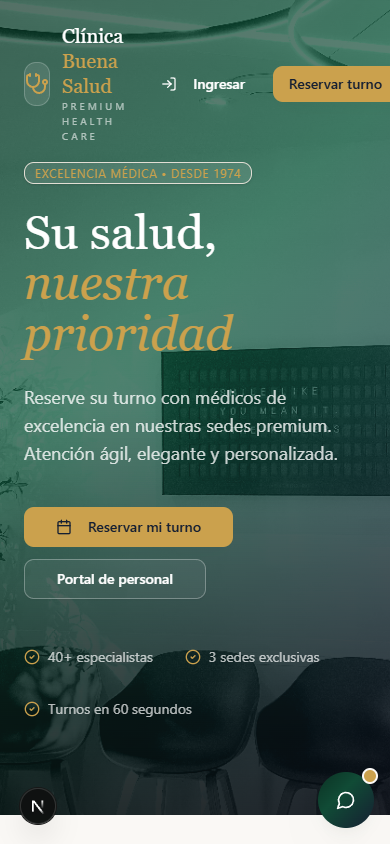

**Figura 32.** Portada en un teléfono. Los accesos principales se mantienen visibles y las tarjetas se apilan.

### 10.2 Centro de ayuda en móvil

El botón **Ayuda** se convierte en un botón circular. Al abrirlo, el panel ocupa el ancho disponible y permite desplazarse por las preguntas frecuentes.

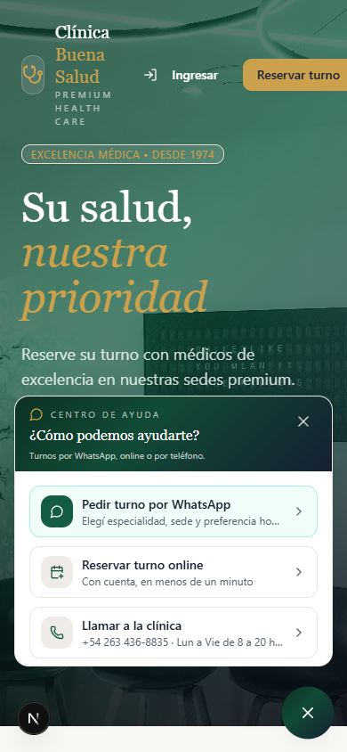

**Figura 33.** Centro de ayuda en móvil. El panel se adapta al ancho de la pantalla y conserva las acciones y los avisos.

### 10.3 Personal en móvil

La navegación interna de recepción, médico y administración está pensada para **escritorio o tablet**. En pantallas pequeñas, el menú superior de secciones se oculta; la vista actual sigue funcionando, pero para cambiar de sección se recomienda usar una pantalla más grande.

### 10.4 Accesibilidad y buenas prácticas

- El panel de ayuda se cierra con `Escape` y tiene etiquetas ARIA.
- Los formularios usan etiquetas visibles y campos obligatorios.
- Los estados se comunican con texto además de color.
- En móvil, usar el zoom del navegador si hace falta leer tablas o agendas.
- Para personas mayores o con dificultad visual, se recomienda acompañar la reserva desde recepción.

---

<a id="sec11"></a>
## 11. Credenciales demo y datos de ejemplo

### 11.1 Cuentas de demostración

La aplicación incluye pestañas de acceso con credenciales precargadas para facilitar la evaluación. Las contraseñas **no se incluyen en este manual** para no exponerlas en un documento versionado. Se encuentran en:

- La pestaña demo de la pantalla **Ingreso al portal** (los campos aparecen completos).
- El archivo local `memory/test_credentials.md`, que **no se sube al repositorio**.

| Perfil | Identificador | Tipo de acceso | 2FA |
|---|---|---|---|
| Paciente | DNI `35678910` | DNI + contraseña | No |
| Recepción | DNI `30111222` | DNI + contraseña | No |
| Médico | `dr.rossi@clinicabuenasalud.com` | Email + contraseña | Sí |
| Administrador | `admin@clinicabuenasalud.com` | Email + contraseña | Sí |

> **Para el entorno de demostración:** las cuentas de médico y administrador ya tienen 2FA configurado. El código se obtiene desde la aplicación autenticadora asociada al entorno. Los secretos TOTP no se documentan aquí.

### 11.2 Datos usados en las capturas

Las capturas usan datos ficticios:

- Paciente: **María González Demo**, DNI `35678910`.
- Médico: **Dr/a. Valentina Rossi**, Cardiología.
- Otras especialidades: Clínica Médica, Oftalmología.
- Sede: **Sede Centro**.
- Fechas: octubre y noviembre de 2026.
- Solicitud de WhatsApp: **María González Demo**, Cardiología, Sede Centro.

Los turnos, evoluciones y solicitudes de las capturas son datos de demostración y no corresponden a personas reales.

### 11.3 Recomendación para producción

Antes de usar la aplicación con pacientes reales:

1. Reemplazar las contraseñas demo.
2. Configurar 2FA para todas las cuentas de médico y administración.
3. Verificar el número de WhatsApp y el teléfono de la clínica.
4. Configurar Turnstile para la reserva online.
5. Revisar las sedes, especialidades, médicos y horarios cargados.
6. Definir quién puede cancelar, reprogramar y cerrar solicitudes.

---

<a id="sec12"></a>
## 12. Solución de problemas

### 12.1 Problemas de acceso

| Problema | Causa probable | Solución |
|---|---|---|
| “DNI o contraseña incorrectos” | DNI mal escrito, contraseña incorrecta o cuenta inexistente | Verificar el DNI sin puntos; revisar mayúsculas; probar la contraseña demo si es el entorno de prueba |
| “Cuenta bloqueada temporalmente” | Cinco intentos fallidos | Esperar 15 minutos o contactar a administración |
| “Este DNI ya tiene una solicitud registrada” | La ficha se creó desde WhatsApp/recepción y no tiene contraseña | Ir a **Crear cuenta** y usar el mismo DNI |
| El ingreso de médico/admin pide 2FA y no se tiene el código | Cuenta con 2FA activo | Usar la app autenticadora o un código de recuperación; si se perdió el acceso, contactar a administración |
| “Código inválido” en 2FA | Código vencido, reloj desincronizado o secreto incorrecto | Esperar el siguiente código; sincronizar la hora del teléfono; revisar que el QR se haya escaneado bien |

### 12.2 Problemas de turnos

| Problema | Causa probable | Solución |
|---|---|---|
| No aparecen horarios | No hay agenda para esa fecha, sede o médico | Probar otra fecha, sede o profesional |
| “No hay disponibilidad en esta fecha” | Todos los horarios están ocupados o bloqueados | Elegir otra fecha |
| “El horario elegido ya no está disponible” | Otra reserva tomó el horario | Volver al paso 4 y elegir otro |
| “Los turnos requieren al menos 2 horas de anticipación” | Horario demasiado cercano | Elegir un horario posterior |
| El turno no aparece en **Mis turnos** | Sesión de otro paciente, DNI distinto o turno cancelado | Verificar el DNI de la cuenta; revisar el estado; consultar a recepción |
| El turno quedó asociado a otra persona | Se cargó un DNI incorrecto | Contactar a recepción para corregir la ficha; no crear otro turno |

### 12.3 Problemas con solicitudes de WhatsApp

| Problema | Causa probable | Solución |
|---|---|---|
| La solicitud no aparece en la bandeja | Filtro activo, solicitud en otro estado o error de red | Probar **Todas**, pulsar **Actualizar**, revisar la conexión |
| El botón **Abrir WhatsApp** no hace nada | Bloqueador de ventanas emergentes | Permitir ventanas emergentes o usar **Copiar mensaje** |
| El mensaje llegó incompleto | Se editó en WhatsApp o se copió mal | Volver a generar la solicitud o copiar el mensaje completo |
| La solicitud no se guardó, pero se puede enviar | Falló el registro en el panel | Enviar el mensaje por WhatsApp y avisar a recepción; la solicitud se puede cargar manualmente |
| El paciente no tiene cuenta | Es normal en solicitudes sin registro | Recepción reserva con el DNI; el paciente puede crear la cuenta después |

### 12.4 Problemas de recepción y administración

| Problema | Causa probable | Solución |
|---|---|---|
| No se puede reservar desde una solicitud | Falta DNI, especialidad o sede; sesión vencida | Completar los datos faltantes; volver a ingresar |
| El turno quedó a nombre de recepción | Se intentó usar la cuenta del personal como paciente | El backend ignora ese dato; corregir el DNI y volver a reservar |
| No se ve el botón **Historial** | El turno no tiene paciente vinculado | Verificar que el turno tenga DNI/ficha; cargar la reserva nuevamente si falta |
| No se puede agregar una evolución | El médico no tiene relación con el paciente o falta motivo/diagnóstico/notas | Verificar que el paciente esté en la agenda del médico; completar al menos un campo clínico |
| El dashboard no cambia | Los datos se cargan al entrar a la vista | Recargar o volver a entrar |

### 12.5 Problemas visuales

| Problema | Causa probable | Solución |
|---|---|---|
| El badge de Netlify tapa el botón **Ayuda** | Badge externo en la esquina inferior izquierda y botón de ayuda en la derecha | La hoja de estilos global ya mueve el badge a la izquierda y lo escala en móvil; si persiste, recargar sin caché |
| La página se ve cortada en móvil | Tabla o agenda ancha | Usar orientación horizontal o una pantalla más grande; el portal de personal está pensado para escritorio |
| El panel de ayuda queda detrás de otro elemento | Conflicto de z-index | Recargar; reportar con navegador y tamaño de pantalla |

---

<a id="sec13"></a>
## 13. Seguridad, privacidad y buenas prácticas

### 13.1 Protección de datos

- El **DNI** se guarda cifrado con AES-GCM y se indexa con un hash determinístico para evitar duplicados sin exponer el valor.
- El **teléfono** y otros datos sensibles también se cifran.
- Las sesiones se firman con un secreto del servidor.
- Los roles limitan el acceso: un paciente solo ve su historial; un médico solo ve pacientes de su agenda.
- Las solicitudes de WhatsApp tienen límite de frecuencia y un campo honeypot anti-bot.
- La reserva online puede exigir un captcha Turnstile.

### 13.2 Contraseñas y 2FA

- Usar contraseñas de al menos 10 caracteres con mayúscula, número y símbolo.
- No compartir contraseñas por WhatsApp, email ni chat.
- Activar 2FA en todas las cuentas de médico y administración.
- Guardar los códigos de recuperación en un lugar seguro.
- Cerrar sesión en equipos compartidos.

### 13.3 Manejo de información clínica

- No enviar diagnósticos, estudios o datos sensibles por el campo de consulta del centro de ayuda.
- El historial clínico es confidencial: consultarlo solo cuando sea necesario para la atención.
- No modificar evoluciones de otros profesionales.
- Si se detecta un error, agregar una nota aclaratoria en lugar de borrar el registro.
- No tomar capturas de pantalla con datos reales sin autorización.

### 13.4 Urgencias

El sitio **no es un canal de urgencias**. Ante una emergencia:

- Llamar al **107 (SAME)** o al **911**.
- No esperar la respuesta de una solicitud de WhatsApp.
- No usar el formulario para describir una urgencia.

### 13.5 Recomendaciones para el personal

- Verificar la identidad del paciente por DNI antes de reservar.
- No reservar turnos a nombre propio ni de otro miembro del personal.
- Confirmar que el teléfono y el email sean del paciente.
- Revisar la bandeja de solicitudes al menos dos veces por turno.
- Marcar las solicitudes como **Contactada** o **Cerrada** para mantener la bandeja limpia.
- Informar a administración si se detecta un acceso extraño o un dato duplicado.

---

<a id="sec14"></a>
## 14. Glosario

| Término | Definición |
|---|---|
| **Turno** | Cita entre un paciente y un médico en una fecha, hora y sede determinadas |
| **Solicitud** | Pedido de turno recibido desde el centro de ayuda, todavía sin reserva confirmada |
| **Evolución clínica** | Registro de una atención: motivo, diagnóstico, tratamiento y notas |
| **Historial clínico** | Conjunto de turnos, solicitudes y evoluciones asociados al DNI de un paciente |
| **DNI** | Documento Nacional de Identidad; identidad principal del paciente |
| **Sede** | Ubicación física de la clínica (Centro, Norte o Sur) |
| **Especialidad** | Área médica (Cardiología, Pediatría, etc.) |
| **2FA** | Doble factor de autenticación mediante un código temporal de 6 dígitos |
| **TOTP** | Algoritmo de códigos temporales usado por las aplicaciones autenticadoras |
| **Bandeja** | Pantalla **Solicitudes** donde recepción y administración gestionan los pedidos |
| **Estado** | Situación actual de un turno o una solicitud |
| **Seed** | Carga inicial de datos de demostración en la base |
| **Captcha** | Prueba anti-bot que puede aparecer al reservar |

---

<a id="sec15"></a>
## 15. Anexos

### Anexo A. Estados de turnos y solicitudes

**Turnos**

| Estado | Se muestra como | Uso |
|---|---|---|
| `pending` | Pendiente | Turno reservado, esperando confirmación |
| `confirmed` | Confirmado | Turno confirmado por recepción |
| `in_room` | En sala | Paciente presente en la clínica |
| `attended` | Atendido | Atención completada |
| `cancelled` | Cancelado | Turno cancelado |
| `no_show` | No asistió | Paciente ausente |

**Solicitudes de WhatsApp**

| Estado | Se muestra como | Uso |
|---|---|---|
| `new` | Nueva | Pedido recibido sin contactar |
| `contacted` | Contactada | Recepción ya contactó al paciente |
| `closed` | Cerrada | Pedido resuelto o descartado |

### Anexo B. Checklist por rol

**Paciente**

- [ ] Ingresar con DNI y contraseña.
- [ ] Revisar **Mis turnos**.
- [ ] Consultar **Historial clínico**.
- [ ] Reservar un turno nuevo si hace falta.
- [ ] Contactar a recepción para cancelar o reprogramar.

**Recepción**

- [ ] Revisar la agenda del día.
- [ ] Confirmar turnos pendientes.
- [ ] Atender la bandeja de solicitudes.
- [ ] Reservar desde WhatsApp con el DNI correcto.
- [ ] Marcar llegadas, atenciones y ausencias.
- [ ] Cerrar sesión al finalizar.

**Médico**

- [ ] Ingresar con email, contraseña y 2FA.
- [ ] Revisar **Mi agenda** del día.
- [ ] Abrir el detalle de cada turno.
- [ ] Registrar la evolución clínica.
- [ ] Marcar **Atendido** o **No asistió**.
- [ ] Cerrar sesión.

**Administración**

- [ ] Revisar **Dashboard**.
- [ ] Supervisar **Agenda**.
- [ ] Revisar **Solicitudes**.
- [ ] Verificar que las cuentas de personal tengan 2FA.
- [ ] Revisar accesos y datos duplicados.

### Anexo C. Índice de capturas

| Figura | Archivo | Sección |
|---|---|---|
| 1 | `01-inicio-portada.png` | 2.2 |
| 2 | `02-inicio-completo.png` | 2.2 |
| 3 | `03-centro-de-ayuda.png` | 3.1 |
| 4 | `04-solicitud-whatsapp-formulario.png` | 3.4 |
| 5 | `05-solicitud-whatsapp-registrada.png` | 3.5 |
| 6 | `06-login-paciente.png` | 4.2 |
| 7 | `07-login-crear-cuenta.png` | 4.3 |
| 8 | `08-configurar-2fa.png` | 4.7 |
| 9 | `09-verificacion-2fa.png` | 4.8 |
| 10 | `10-paciente-mis-turnos.png` | 5.2 |
| 11 | `11-paciente-historial.png` | 5.4 |
| 12 | `12-reserva-paso-1-especialidad.png` | 5.5 |
| 13 | `13-reserva-paso-2-sede.png` | 5.6 |
| 14 | `14-reserva-paso-3-medico.png` | 5.7 |
| 15 | `15-reserva-paso-4-horario.png` | 5.8 |
| 16 | `16-reserva-paso-5-datos.png` | 5.9 |
| 17 | `17-reserva-confirmada.png` | 5.10 |
| 18 | `18-recepcion-agenda.png` | 6.2 |
| 19 | `19-recepcion-turno-detalle.png` | 6.3 |
| 20 | `20-recepcion-historial.png` | 6.4 |
| 21 | `21-recepcion-solicitudes.png` | 6.5 |
| 22 | `22-recepcion-reserva-desde-whatsapp.png` | 6.6 |
| 23 | `23-recepcion-reserva-datos.png` | 6.6 |
| 24 | `24-recepcion-reserva-confirmada.png` | 6.6 |
| 25 | `25-medico-agenda.png` | 7.2 |
| 26 | `26-medico-turno-detalle.png` | 7.3 |
| 27 | `27-medico-historial.png` | 7.4 |
| 28 | `28-medico-nueva-evolucion.png` | 7.5 |
| 29 | `29-admin-dashboard.png` | 8.2 |
| 30 | `30-admin-agenda.png` | 8.3 |
| 31 | `31-admin-solicitudes.png` | 8.4 |
| 32 | `32-movil-inicio.png` | 10.1 |
| 33 | `33-movil-centro-de-ayuda.png` | 10.2 |

### Anexo D. Notas técnicas para soporte

- **Persistencia:** PostgreSQL con documentos `jsonb`; los identificadores son UUID.
- **Identidad:** el paciente se resuelve por DNI; el DNI se cifra y se indexa por hash.
- **Reserva:** la API valida disponibilidad, solapamientos y una anticipación mínima de 2 horas.
- **Recepción:** el backend ignora `patientId` cuando quien reserva es personal y exige `patientDni`; así el turno nunca queda asociado a la cuenta de recepción.
- **Solicitudes:** al reservar desde una solicitud, esta pasa a `contacted` automáticamente.
- **2FA:** TOTP de 6 dígitos; los códigos de recuperación se muestran una sola vez.
- **Límites:** el ingreso tiene límite de intentos; las solicitudes públicas tienen límite de 5 cada 10 minutos por IP y honeypot.
- **Badge de Netlify:** la regla global lo ubica abajo a la izquierda, con menor z-index que el botón **Ayuda** y escala reducida en móvil, para que no se superpongan.
- **Capturas:** generadas con Chrome real y Playwright; viven en `docs/manual/img/`.

---

<a id="sec16"></a>
## 16. Control de versiones

| Versión | Fecha | Cambios |
|---|---|---|
| 1.0 | 28/10/2026 | Manual completo del sitio: público, ayuda, acceso, paciente, recepción, médico, administrador, móvil, solución de problemas y anexos. Incluye 33 capturas reales. |

---

**Fin del manual.**

Para consultas sobre este documento, contactar al equipo de administración de Clínica Buena Salud.
